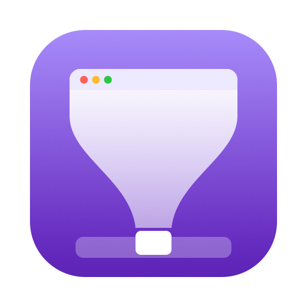
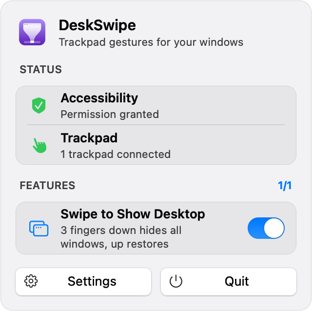
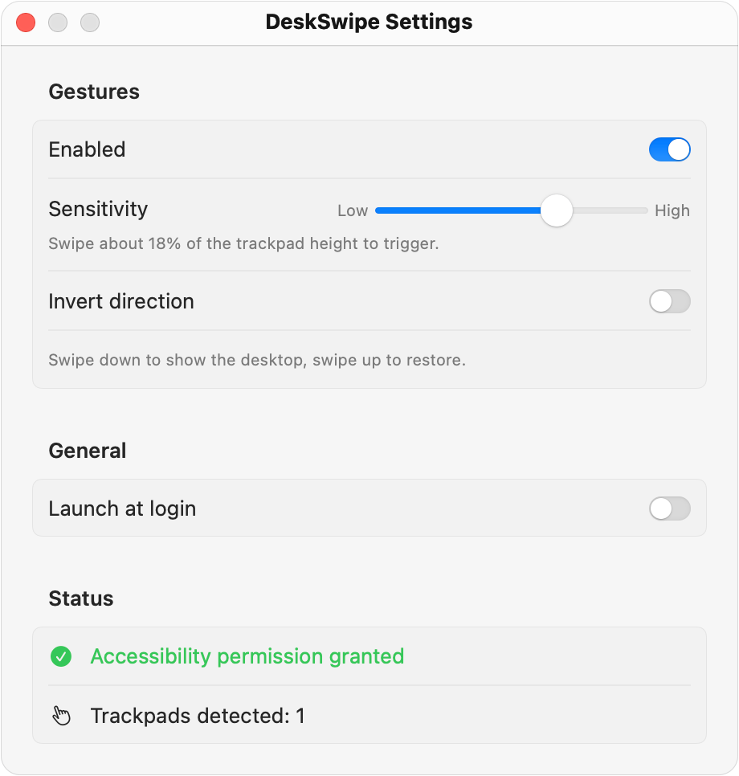

<p align="center">
  
</p>

<h1 align="center">DeskSwipe</h1>

<p align="center">
  <b>Windows-style "Show Desktop" for your Mac trackpad.</b><br>
  Three fingers down hides every window. Three fingers up brings back exactly those windows.
</p>

<p align="center">
  
  
  
  <a href="LICENSE"></a>
</p>

<p align="center">
  <a href="https://github.com/adarsh-pandey07/DeskSwipe/releases/latest"></a>
</p>

## Highlights

- **3-finger swipe down** minimizes every window on the current Space, and remembers exactly which ones it hid.
- **3-finger swipe up** brings back only those windows. Windows you minimized yourself stay put.
- **Click a Dock thumbnail** to bring back a single window; DeskSwipe notices and leaves it alone.
- **Menu bar panel** with live status and an on/off switch per feature. No Dock icon.
- **Adjustable sensitivity**, inverted direction, launch at login.
- **Free and dependency-free:** builds with Apple's Command Line Tools, no Xcode needed.

See [FEATURES.md](FEATURES.md) for the full feature list, capabilities and backlog.

## Screenshots

<table>
  <tr>
    <th>Menu bar panel</th>
    <th>Settings</th>
  </tr>
  <tr>
    <td align="center" valign="top">
      <picture>
        <source media="(prefers-color-scheme: dark)" srcset="docs/images/panel-dark.png">
        
      </picture>
    </td>
    <td align="center" valign="top">
      <picture>
        <source media="(prefers-color-scheme: dark)" srcset="docs/images/settings-dark.png">
        
      </picture>
    </td>
  </tr>
</table>

## Requirements

- macOS 14 (Sonoma) or later, Apple Silicon
- A built-in trackpad or Magic Trackpad
- To build from source: Xcode **or** just the Command Line Tools (`xcode-select --install`), with Swift 5.10 or newer

## Install

1. Download **DeskSwipe-x.y.z.dmg** from the [latest release](https://github.com/adarsh-pandey07/DeskSwipe/releases/latest). Optionally check it against the SHA-256 in the release notes: `shasum -a 256 ~/Downloads/DeskSwipe-*.dmg`.
2. Open the DMG and drag **DeskSwipe** onto **Applications**.
3. Open DeskSwipe from Applications. Because the app isn't notarized by Apple (that needs a paid developer account), macOS blocks the first launch with a message that it couldn't verify the app. Click **Done**, not *Move to Trash*.
4. Open **System Settings → Privacy & Security**, scroll down to the message about DeskSwipe being blocked, click **Open Anyway**, and confirm with your password or Touch ID.

   Terminal alternative: `xattr -dr com.apple.quarantine /Applications/DeskSwipe.app`, then open the app.
5. Continue with [First-run setup](#first-run-setup) below: grant Accessibility and move macOS's own 3-finger swipes to 4 fingers.

DeskSwipe appears in the menu bar (no Dock icon). Click its icon to open the panel.

## Build from source

```sh
./build.sh
```

This runs the unit tests, builds a release binary for arm64, assembles `build/DeskSwipe.app` with its `Info.plist` (`LSUIElement = true`) and icon, and signs it. Set `SKIP_TESTS=1` to skip the tests.

To package it as a DMG (the same kind attached to releases):

```sh
./scripts/make-dmg.sh
```

This creates `build/DeskSwipe-<version>.dmg` containing the app and an **Applications** shortcut for drag-to-install, using macOS's `diskutil`. The script then mounts the DMG read-only, checks that the app's signature is intact, ejects it, and prints its SHA-256 checksum.

### Keep permissions across rebuilds (recommended if you develop)

By default the app is ad-hoc signed (`codesign -s -`). macOS ties the Accessibility permission to that exact build, so every rebuild needs permission granted again. Run once:

```sh
./scripts/setup-signing.sh
```

This creates a self-signed **DeskSwipe Local Signing** certificate in your login keychain. It is local only, free, and grants no extra trust. `build.sh` uses it automatically when it exists; delete it in Keychain Access to go back to ad-hoc signing. Grant Accessibility once more after the first build signed this way, and from then on rebuilds keep it.

Install and launch:

```sh
ditto build/DeskSwipe.app /Applications/DeskSwipe.app
open /Applications/DeskSwipe.app
```

For development:

```sh
swift build
swift test
swift run DeskSwipe     # runs unbundled; prefer the .app for real use
```

## First-run setup

### 1. Accessibility permission (required)

DeskSwipe minimizes and restores windows through the Accessibility API. On first launch macOS shows a prompt:

1. Click **Open System Settings**, or click the menu bar icon and press **Grant…** next to *Accessibility needed*.
2. In **Privacy & Security > Accessibility**, switch on **DeskSwipe**.

The panel's **Status** section shows whether permission is granted. DeskSwipe checks every couple of seconds and picks up the change without a restart.

### 2. Move macOS's own 3-finger swipes out of the way (strongly recommended)

By default macOS uses 3-finger swipe up/down for Mission Control and App Exposé, so both would fire at once. DeskSwipe detects this and shows a *Gesture conflict* row in the panel and a warning in Settings. To fix it:

**System Settings > Trackpad > More Gestures**: set **Mission Control** and **App Exposé** to **Swipe Up/Down with Four Fingers**, or **Off**.

If you use **three-finger drag** (System Settings > Accessibility > Pointer Control > Trackpad Options), it also turns 3-finger movement into drags. DeskSwipe warns about that too.

DeskSwipe does not change these settings for you.

## Settings

Open from the menu bar panel: **Settings** (⌘,).

| Setting | What it does |
|---|---|
| Enabled | Turns gesture handling on or off. Same as the **Swipe to Show Desktop** switch in the menu bar panel. |
| Sensitivity | How far you must swipe: from ~40% of trackpad height (Low) to ~8% (High). The default is 18%. |
| Invert direction | Swipe up to show the desktop, swipe down to restore. |
| Launch at login | Registers the app with `SMAppService.mainApp`. macOS may ask you to approve it under General > Login Items. |

Settings are stored in UserDefaults (`defaults read local.deskswipe.DeskSwipe`).

## How gestures are recognized

A swipe fires **once per gesture**, when all of these hold:

- exactly 3 fingers are on the surface;
- vertical travel within the last 0.6 s reaches the sensitivity threshold;
- vertical travel is more than 1.5× horizontal travel.

Lifting fingers or changing the finger count starts a new gesture. If a gesture ever reaches 4+ fingers, it is ignored until every finger has lifted. Slow drift never fires, because travel is measured over a short sliding window.

## Known limits

- **Current Space only.** The Accessibility API only reports windows on the active Space, so DeskSwipe minimizes (and later restores) only those. Windows on other Spaces are left alone. This is by design.
- **Full-screen windows are skipped.** macOS cannot minimize them this way. The same goes for floating panels and windows without a minimize control.
- **Only regular apps** (apps with a Dock icon) are affected. DeskSwipe never touches its own windows.
- **Private framework.** Trackpad input comes from Apple's private `MultitouchSupport` framework, loaded at runtime. A future macOS update could change or remove it. If that happens, the panel shows "Gesture input unavailable" and the app keeps running.
- Only the last swipe down is remembered. For example: hide everything, bring one window back from the Dock, swipe down again, and the next swipe up brings back just that window; the others stay minimized in the Dock. A swipe down when nothing is visible keeps the memory. Memory is not kept across quitting DeskSwipe.
- Restore order: windows come back in their original stacking order as far as possible, with the frontmost last.

## Troubleshooting

**Nothing happens when I swipe.**
- Open the menu bar panel: is Accessibility **granted**? Is the **Swipe to Show Desktop** switch on? Is a trackpad connected?
- **After a rebuild** (ad-hoc signing, or the first build after running `scripts/setup-signing.sh`), the old Accessibility entry stops working even though it still looks enabled; toggling it does nothing. Remove DeskSwipe from the list with **−** and add it again, or reset it:
  ```sh
  tccutil reset Accessibility local.deskswipe.DeskSwipe
  ```
  Then relaunch DeskSwipe and grant permission again. To stop this happening on every rebuild, see *Keep permissions across rebuilds*.
- Try a higher sensitivity in Settings.

**Mission Control / App Exposé opens as well.** See *First-run setup, step 2*.

**Gestures stop after connecting a Magic Trackpad, or after sleep.** DeskSwipe re-enumerates devices about a second after a trackpad connects or disconnects, and after wake. If gestures still don't work, turn the **Swipe to Show Desktop** switch off and on, or quit and relaunch.

**Some windows were not minimized.** They may be full screen, on another Space, a floating panel, or in an app that doesn't respond to Accessibility requests (DeskSwipe waits at most 1 s per request).

**A window I restored by hand came back minimized/restored unexpectedly.** It shouldn't: restoring a window yourself (Dock thumbnail, Cmd-Tab, etc.) removes it from DeskSwipe's list. If you can reproduce this, please capture logs (below).

**Launch at login doesn't stick.** Approve DeskSwipe in **System Settings > General > Login Items**. Keep the app in one place (e.g. `/Applications`); moving it breaks the registration.

**Logs.**

```sh
/usr/bin/log stream --info --predicate 'subsystem == "DeskSwipe"'
```

(Use the full path `/usr/bin/log`, because zsh has a built-in `log` command.)

**`swift test` fails with "plugin for module 'TestingMacros' not found".** Some Command Line Tools releases don't pass the Swift Testing macro plugin path to every compile step. `Package.swift` adds it automatically when `/Library/Developer/CommandLineTools/usr/lib/swift/host/plugins/testing` exists. If your tools live elsewhere, pass it yourself:
`swift test -Xswiftc -plugin-path -Xswiftc <toolchain>/usr/lib/swift/host/plugins/testing`.

## Project layout

```
Sources/DeskSwipeCore/          Pure logic, unit tested
  SwipeRecognizer.swift         Frames -> .swipeDown / .swipeUp
  MTTouch.swift                 Typed 96-byte MTTouch struct + frame reduction
  ShowDesktopController.swift   Which windows the last swipe minimized; forget/restore
  GestureConflicts.swift        Detects conflicting system gesture settings
Sources/DeskSwipe/              The app
  MultitouchService.swift       dlopen/dlsym MultitouchSupport, hot-plug, wake
  WindowManager.swift           AXUIElement backend, AXObservers, app-quit cleanup
  StatusBarController.swift     Menu bar item and its status/feature panel
  SettingsView.swift            SwiftUI settings window
  AppSettings.swift             UserDefaults-backed preferences
  SystemStatus.swift            Accessibility, conflicts, devices, login item
  AppDelegate.swift, main.swift
Tests/DeskSwipeCoreTests/       Swift Testing suites
Resources/Info.plist
Resources/AppIcon.svg          Icon source; scripts/make-icon.sh regenerates AppIcon.icns
scripts/make-icon.sh            Renders AppIcon.svg into AppIcon.icns
scripts/setup-signing.sh        Creates the local signing identity
scripts/make-dmg.sh             Packages build/DeskSwipe.app into a DMG
build.sh
FEATURES.md                     Feature & capability tracker, backlog, changelog
docs/images/                    README screenshots, icon and GitHub social preview
reference/main.swift            Original single-file prototype
```

## Uninstall

Quit DeskSwipe from its panel, turn off Launch at login first if you enabled it, then:

```sh
rm -rf /Applications/DeskSwipe.app
defaults delete local.deskswipe.DeskSwipe
tccutil reset Accessibility local.deskswipe.DeskSwipe
```

## Releasing a new version

1. Bump `CFBundleShortVersionString` (and increase `CFBundleVersion`) in `Resources/Info.plist`, and add a changelog entry in [FEATURES.md](FEATURES.md).
2. Build and package:
   ```sh
   ./build.sh
   ./scripts/make-dmg.sh
   ```
3. Commit, push, and publish the release with the DMG attached:
   ```sh
   gh release create vX.Y.Z build/DeskSwipe-X.Y.Z.dmg --title "DeskSwipe X.Y.Z" --notes "..."
   ```

## License

[MIT](LICENSE) © 2026 Adarsh Pandey
